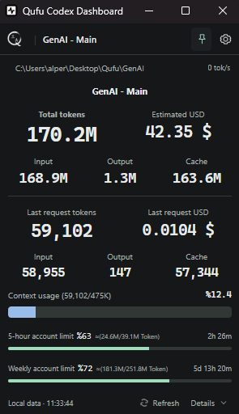

# Qufu Codex Dashboard

A compact desktop companion for tracking Codex sessions, token usage and account limits.

**Version 1.0 · Windows & Linux · Author: [alper@qufu.io](mailto:alper@qufu.io)**

[Downloads / İndir](https://github.com/qufu-io/qufu-codex-dashboard-releases/releases) · [Türkçe](#türkçe) · [English](#english) · [qufu.io](https://qufu.io)

  

> **1.0 güncelleme sürümü son test aşamasında. Kurulum paketleri test onayından sonra Releases bölümüne eklenecek.**
> **The updated 1.0 build is undergoing final testing. Installers will appear in Releases after acceptance.**

## Türkçe

Qufu Codex Dashboard, Codex kullanımını küçük bir masaüstü penceresinden takip etmeni sağlar. Tauri 2 ile geliştirilmiştir; Windows ve Linux üzerinde çalışır.

### Özellikler

- Workspace ve session seçimi; arşivlenmiş, internal ve subagent kayıtlarını ana listeden ayıran otomatik filtreleme.
- Toplam ve son tamamlanan model yanıtı için Input, Output, Cache tokenları ve tahmini USD maliyeti.
- Son 60 saniyeden hesaplanan canlı token/saniye değeri.
- Ölçülmüş context kullanımı ve session tarafından bildirilen context kapasitesi.
- 5 saatlik ve haftalık hesap limitleri, reset sayaçları ve veri yeterliyse açıkça işaretlenmiş tahmini token eşdeğerleri.
- Detaylar panelinde subagent tüketimi, model dökümü ve hesap abonelik türü.
- Her zaman üstte, sistem tepsisi, hatırlanan pencere ayarları, şeffaflık, koyu/açık tema ve Türkçe/İngilizce dil seçimi.
- Varsayılan kapalı Auto Follow Beta; seçili Desktop session doğrulanamıyorsa manuel seçimi korur.

### Ä°ndirme ve kurulum

Uygulama **ücretsizdir ve kapalı kaynaklıdır**. Public dağıtım deposundan GitHub hesabı veya davet gerektirmeden indirebilirsin. Kaynak kodu bu depoda paylaşılmaz.

1. [1.0 sürümünü aç](https://github.com/qufu-io/qufu-codex-dashboard-releases/releases).
2. **Assets** bölümünü genişlet.
3. Ä°ÅŸletim sistemine uygun paketi indir:

| Platform | Paket | Kurulum |
| --- | --- | --- |
| Windows x64 | `*_x64-setup.exe` | Dosyayı çalıştır; kurulumdan sonra Başlat menüsünden aç. |
| Ubuntu / Debian amd64 | `*_amd64.deb` | `sudo apt install ./indirilen-dosya.deb` |
| Linux x64 | `*_amd64.AppImage` | `chmod +x indirilen-dosya.AppImage` ardından dosyayı çalıştır. |

**Gereksinimler:** Yerel session verisi oluşturan Codex kurulumu. Canlı hesap limitleri için oturum açılmış Codex CLI (`codex` komutu PATH üzerinde) gerekir. Windows kurucusu WebView2'yi kontrol eder; eksikse internetten indirip otomatik kurar. WebView2 kurulumu başarısız olursa uygulama kurulumu durur. Linux'ta WebKitGTK 4.1 ve çalışan bir masaüstü oturumu gerekir; GNOME'da tray için AppIndicator eklentisi gerekebilir. Wayland, pencere konumunu ve her zaman üstte davranışını sınırlandırabilir.

**Güncelleme:** Eski uygulamayı tray menüsündeki **Quit / Çıkış** ile kapat, ardından yeni kurulumu çalıştır. Pencerenin X düğmesi uygulamayı tray'e gizler.

### Kullanım

Üstteki workspace/session adına tıklayıp takip edeceğin session'ı seç. Detaylar paneli model ve subagent dökümünü gösterir. Ayarlardan dil, tema, şeffaflık ve her zaman üstte seçeneklerini değiştirebilirsin.

Alt satır son limit güncelleme saatini gösterir; eski veride ne kadar süre geçtiği belirtilir.

Varsayılanlar: İngilizce, %33 şeffaflık, 300 piksel genişliğinde kompakt görünüm. Yükseklik içeriğe uyar; pencere ve sonraki tercihler hatırlanır. Context %80'i, hesap limitleri %90'ı aşınca ilgili bar ve yüzde uyarı rengine döner.

### Veriler ve hesaplama

- Yerel Codex metadata ve session kayıtları salt okunur kullanılır. `CODEX_HOME` ayarlıysa bu klasör, yoksa `~/.codex` okunur. Liste keşfinde tarih sınırı veya elle yazılmış session adları yoktur.
- Cache, Input'un; reasoning, Output'un alt kümesidir. Toplamda tekrar eklenmez. Ana session ve subagent tüketimleri ayrı sunulur.
- Bilinmeyen kullanım veya fiyat sıfır gösterilmez. Son istek, son tamamlanan **model yanıtıdır**; bir kullanıcı mesajı birden fazla model yanıtı içerebilir.
- USD tutarları API eşdeğeri tahmindir; abonelik faturası değildir. Resmi [OpenAI fiyatları](https://developers.openai.com/api/docs/pricing) her açılışta kontrol edilir; erişilemezse son geçerli fiyat, ilk açılışta ise dahil edilen fiyat tablosu kullanılır.
- Context miktarı ölçülmüş değerdir. Kapasite abonelikten tahmin edilmez.
- Hesap limitleri `account/rateLimits/read` üzerinden alınır. OpenAI sabit token kotası bildirmez. `≈` işaretli miktarlar, yerel fiyat ağırlıklı kalibrasyondan tahmini token eşdeğeridir; resmi kota veya hesap genelinde ölçülmüş harcama değildir. Yeterli/güvenilir veri yoksa miktarlar bilinmiyor gösterilir. Başka cihaz ve bulut kullanımı tahminlerin doğruluğunu etkileyebilir.
- Yerel kullanım kaydı bulunmayan bulut/ChatGPT sohbetleri listelenmez. Auto Follow doğrulanmış Desktop seçimi bulunamazsa manuel kalır.

### Gizlilik ve paylaşım

Uygulama konuşmaları ve kullanım kayıtlarını bir dashboard sunucusuna yüklemez; kimlik doğrulama token dosyalarını okumaz. Ağ erişimi resmi fiyat kontrolü, kurulu Codex'in hesap limit okuyucusu ve GitHub güncelleme kontrolü/indirmesi içindir.

Ayarlar → **Güncellemeleri kontrol et** ile yeni sürümü sorgulayabilirsin. Yeni sürüm bulunduğunda **İndir ve kur** düğmesine tıklaman gerekir; kurulum kendiliğinden başlamaz. Paket imzası ve imzalanmış sürüm numarası doğrulanır. Windows kurulum sırasında kapanabilir; Linux'ta uygulama yeniden başlatılır. GitHub düğmesiyle tüm sürümleri tarayıcıda açabilirsin. İnternet veya yayın manifesti erişilemezse kontrol başarısız olarak gösterilir; uygulama güncelmiş gibi davranmaz.

Uygulama ücretsiz kullanılabilir; kaynak kodu, değiştirme, yeniden dağıtma veya satış hakkı verilmez. Ayrıntılar için [kullanım lisansını](LICENSE) incele.

## English

Qufu Codex Dashboard is a compact Tauri 2 desktop monitor for local Codex usage on Windows and Linux.

### Features

- Workspace/session picker with automatic filtering of archived, internal and linked agent records.
- Total and last completed model-response Input, Output and Cache tokens, with separate estimated USD costs.
- Live tokens/second, calculated from the preceding 60 seconds.
- Measured context usage and the capacity reported by the session.
- Five-hour and weekly account limits, reset timers and clearly marked approximate token equivalents when calibration is available.
- Model breakdown, subscription type and separate subagent consumption in Details.
- Tray integration, always-on-top, remembered window settings, transparency, dark/light themes and English/Turkish localization.
- Auto Follow Beta is off by default and preserves manual selection when the selected Desktop session cannot be verified.

### Download and install

The application is **free to use and closed-source**. Downloads are public and do not require a GitHub account or invitation. Application source code is not distributed in the downloads repository.

Open [Release 1.0 → Assets](https://github.com/qufu-io/qufu-codex-dashboard-releases/releases) and select your package:

| Platform | Package | Installation |
| --- | --- | --- |
| Windows x64 | `*_x64-setup.exe` | Run the installer, then open the app from the Start menu. |
| Windows x64 portable | `QufuCodexDashboard-1.0.exe` | Run the executable; WebView2 must be installed. |
| Ubuntu / Debian amd64 | `*_amd64.deb` | `sudo apt install ./downloaded-file.deb` |
| Linux x64 | `*_amd64.AppImage` | `chmod +x downloaded-file.AppImage`, then run it. |

Local Codex session records are required. Live account limits require a signed-in Codex CLI available as `codex` on PATH. The Windows installer detects WebView2 and automatically downloads/installs it when missing; this requires internet access. Installation stops if the runtime cannot be installed. Linux requires WebKitGTK 4.1 and a graphical session; GNOME may need an AppIndicator extension for the tray. Wayland can restrict window positioning and always-on-top behavior.

Before updating, use **Quit** in the tray menu to close the running app. Closing the window only hides it to the tray.

### Use and accuracy

The footer shows the last limit-update time and the age of stale data.

Select a workspace/session from the header. Open Details for model and subagent usage, or Settings for appearance and language. Defaults are English, 33% transparency and a 300 px compact window that fits its content. Preferences persist. Context warns above %80; account limits warn above %90.

Local metadata and logs are read without modification from `CODEX_HOME`, or `~/.codex`. Session discovery has no date cutoff or hard-coded names. Cache is included in Input and reasoning in Output; neither is added twice. Response IDs deduplicate usage, while main and linked-agent counters remain separate. Last request means the last completed model response, not an entire user turn.

Unknown values remain unavailable. USD is an API-equivalent estimate, not a subscription bill. The official [OpenAI pricing table](https://developers.openai.com/api/docs/pricing) is checked on every launch, with last-good cache and bundled first-launch fallback. Context uses measured usage and session-reported capacity, never a subscription-based guess.

Account percentages come from the installed Codex `account/rateLimits/read` interface. OpenAI does not report a fixed token allowance. Fractions marked `≈` are estimated token equivalents from local price-weighted calibration, not official quotas or measured account-wide spending. Insufficient or unstable calibration remains unavailable; other devices and cloud use can affect accuracy. Cloud/ChatGPT conversations without local usage records are not listed. Auto Follow keeps manual selection when Desktop selection cannot be verified.

The app does not upload conversations or usage logs to a dashboard server and does not read authentication token files. Network activity is limited to public pricing requests, the installed Codex account reader, and GitHub update checks/downloads.

### Updates and license

Open Settings → **Check for updates**. When a newer release is found, click **Download and install** to approve installation. The package signature and signed version are verified first. Windows may close during installation; Linux restarts the app afterward. The GitHub button opens the releases page. A failed network or missing release manifest is reported as a failed check, never as proof that the app is current.

Use is free. Application source, modification, redistribution and resale rights are not granted. See the [freeware license](LICENSE). Third-party components retain their own licenses.

## Author / Yazar

**[alper@qufu.io](mailto:alper@qufu.io)**

[qufu.io](https://qufu.io)

Copyright © 2026 alper@qufu.io. All rights reserved. The application is free to use under the [freeware license](LICENSE); its source code is not publicly distributed.

The in-app Qufu logo is supplied by the author. System icons use the approved Lucide Square Activity adaptation; see the [ISC license and attribution](docs/third-party/LUCIDE-LICENSE).
